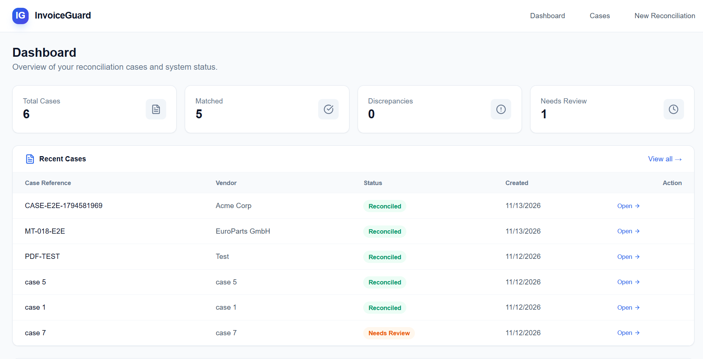

# InvoiceGuard

AI-Assisted Invoice Reconciliation and Verification System.

Compares Purchase Order (PO), Vendor Invoice, and Goods Receipt Note (GRN)
documents, extracts their contents via AI, performs deterministic financial
reconciliation, identifies discrepancies, and produces evidence-backed reports.

## Screenshots

> Take 2–3 screenshots of the running frontend and save them here, then
> uncomment and update the paths below:

<!--



-->

## Features

- **Case management** — create, list, view, and delete reconciliation cases
- **Document upload** — PO, Vendor Invoice, and GRN PDFs per case
- **AI extraction** — LLM-powered document parsing with few-shot prompting
- **Deterministic reconciliation** — price, quantity, missing item,
  unbilled receipt, reference mismatch, and arithmetic checks
- **Plain language explanations** — human-readable "what this means" per finding
- **Reports** — PDF and CSV download per case
- **Auto-cleanup** — 7-day case retention + manual cleanup endpoint

## Architecture

**AI interprets documents; deterministic Python verifies financial facts.**
- LLM provider — document extraction via environment-driven API adapter
- Deterministic Python — decimal-safe arithmetic, line-item matching,
  discrepancy classification, final reconciliation status

## Stack

| Component | Technology |
|-----------|------------|
| Backend | Python 3.12 + FastAPI + SQLAlchemy + Pydantic |
| Database | PostgreSQL |
| PDF extraction | PyMuPDF |
| AI provider | LLM API (env-driven, provider-agnostic) |
| Reports | reportlab (PDF) + csv |
| Testing | pytest |
| Frontend | Next.js 14 + TypeScript + Tailwind CSS |

## Quick Start

```bash
# Backend
cd backend
python -m venv .venv
.venv\Scripts\activate
pip install -r requirements.txt
copy .env.example .env   # set LLM_API_KEY and DATABASE_URL
uvicorn app.main:app --reload --port 8000

# Frontend
cd frontend
npm install
npm run dev
```

- Backend: `http://localhost:8000`
- Frontend: `http://localhost:3000`

## Testing

```bash
cd backend
pytest tests/ -q
```

**14 passed** (11 unit + 3 integration).

## Configuration

Copy `.env.example` to `.env` and fill in your values. Never commit real
credentials — `.env` is gitignored.
